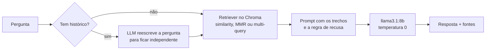

# rag-gta

RAG local, sem API paga e sem mandar dados para fora da máquina: **Ollama** (`llama3.1:8b` e
`nomic-embed-text`) + **Chroma** + **LangChain**. Responde em português sobre dois corpora:

- **lore:** o universo Grand Theft Auto, a partir de artigos do GTA Wiki, com a fonte de cada resposta;
- **glossary:** um glossário de localização de games EN → PT-BR, que mostra o mesmo pipeline num domínio de
  terminologia, em que a resposta precisa sair *exatamente* como está na fonte.

E tem um **conjunto de avaliação** que mede separadamente se o sistema achou o trecho certo, se respondeu
certo e se admitiu quando não sabia.

## Como funciona



- **Ingestão** (`rag_gta/corpus.py`): o texto de lore é dividido por artigo do wiki (cada artigo traz a sua URL)
  e depois em trechos de 1.500 caracteres com 300 de sobreposição; cada trecho guarda o título e a URL do
  artigo de origem. O glossário vira **um documento por termo**, sem divisão: um trecho que separa o termo da
  tradução não serve para nada.
- **Recuperação** (`rag_gta/pipeline.py`): três modos, escolhidos por `--mode`.
  - `similarity`: os *k* trechos mais próximos. Padrão do glossário (k = 4).
  - `mmr`: relevantes mas diferentes entre si, para não trazer *k* pedaços do mesmo parágrafo. Padrão da lore (k = 8).
  - `multiquery`: o LLM reescreve a pergunta de vários jeitos e junta os resultados. Custa uma chamada a mais.
- **Geração:** o prompt manda usar só os trechos e, sem resposta neles, dizer uma frase fixa de recusa, o que
  torna a recusa mensurável.
- **Conversa:** no modo `chat`, uma pergunta como «e o irmão dele?» é reescrita com o histórico antes da busca.

## Como rodar

Pré-requisitos: Python 3.11+ e [Ollama](https://ollama.com) rodando.

```bash
ollama pull llama3.1:8b
ollama pull nomic-embed-text

python -m venv .venv
source .venv/bin/activate        # Windows: .venv\Scripts\activate
pip install -r requirements.txt

# Glossário: o arquivo já está no repositório
python -m rag_gta ask glossary "Como traduzo cooldown?"
python -m rag_gta eval glossary

# Lore: o corpus é montado do GTA Wiki (seção «Os dados»)
python -m rag_gta.lore_corpus
python -m rag_gta index lore
python -m rag_gta ask lore "Quem é o irmão de Carl Johnson?" --show-chunks
python -m rag_gta chat lore
python -m rag_gta eval lore --mode mmr
python -m rag_gta eval lore --mode multiquery
```

O índice vetorial fica em `data/chroma/<corpus>/` e só é montado na primeira vez (`--rebuild` refaz).
Modelos diferentes: variáveis `RAG_LLM` e `RAG_EMBED`.

## Avaliação

`eval/glossary.jsonl` (15 perguntas com resposta + 4 que devem ser recusadas) e `eval/lore.jsonl`
(10 + 3). Cada pergunta com resposta lista os termos esperados; o placar ignora maiúsculas e acentos.

| Métrica | O que mede | Se estiver baixa, mexa em |
|---|---|---|
| `retrieval_hit` | o termo esperado estava nos trechos recuperados | divisão em trechos, *k*, modo de busca, embeddings |
| `answer_hit` | o termo esperado está na resposta (e ela não é recusa) | prompt, modelo |
| `false_refusal` | o modelo recusou uma pergunta que tinha resposta | prompt (regra de recusa muito forte) |
| `refusal_ok` | o modelo recusou a pergunta fora do corpus | prompt (alucinação) |

### Resultados

Glossário, `llama3.1:8b` + `nomic-embed-text`, runner do GitHub Actions só com CPU, 05/11/2026
([rodada](https://github.com/ddmdros/rag-gta/actions/runs/42052451659)):

| Modo | `retrieval_hit` | `answer_hit` | `false_refusal` | `refusal_ok` | s/pergunta |
|---|---|---|---|---|---|
| similarity | 15/15 | 15/15 | 0 | 3/4 | 16 |
| mmr | 14/15 | 14/15 | 0 | 3/4 | 16 |
| multiquery | 15/15 | 15/15 | 0 | 4/4 | 66 |

- Com `similarity` e `mmr`, o modelo responde sobre *perk*, que não está no glossário, em vez de recusar.
  O `multiquery` acerta a recusa, mas custa cerca de 4 vezes mais tempo por pergunta.
- O `mmr` perde *damage per second*: ao buscar trechos diferentes entre si, deixa de fora o termo mais próximo.
  Num glossário, em que cada documento é um termo, diversidade atrapalha; por isso o padrão do glossário é `similarity`.

Cada rodada grava as respostas, as fontes e o resumo em `eval/results/`, para comparar configurações. Os
termos esperados do glossário são conferidos contra o CSV num teste (`tests/test_evaluate.py`): a avaliação
testa o sistema, não a memória de quem escreveu as perguntas.

Sem máquina local, a avaliação roda no GitHub Actions: workflow **Eval** (Actions → Eval → Run workflow), que
instala o Ollama no runner, roda os modos pedidos e publica o resumo da rodada e os arquivos de `eval/results/`.
O runner só tem CPU, então uma rodada leva dezenas de minutos, mas o placar é o mesmo.

## Os dados

- **Glossário** (`data/glossario_gamer_ptbr.csv`): *Video Games Localization Glossary – Portuguese (Brazil)*,
  esforço coletivo de tradutores, distribuído sob [CC BY-NC 4.0](https://creativecommons.org/licenses/by-nc/4.0/).
  Usado aqui sem fins comerciais e com esta atribuição.
- **Lore** (`data/gta_bible.txt`, fora do git): texto de artigos do [GTA Wiki](https://gta.fandom.com),
  cujo conteúdo está sob [CC BY-SA](https://www.fandom.com/licensing). O texto não é versionado: `python -m rag_gta.lore_corpus`
  baixa pela API do wiki uma lista fixa de artigos (os protagonistas, as pessoas em volta deles, as cidades e os
  jogos que a avaliação pergunta) e guarda só a prosa, sem infobox, tabela nem referências. A lista é fixa para
  que qualquer pessoa remonte o mesmo corpus e compare rodadas. Os artigos estão em inglês e as perguntas, em
  português, então a avaliação da lore também testa a busca entre idiomas. A primeira versão do projeto usava
  um corpus montado por outro script de raspagem, que não está no repositório.

  Para usar outros artigos, monte o seu `.txt` no mesmo formato, com a URL de cada artigo numa linha antes do texto:

  ```text
  https://gta.fandom.com/wiki/Carl_Johnson
  Carl Johnson, também conhecido como CJ, é o protagonista de Grand Theft Auto: San Andreas...

  https://gta.fandom.com/wiki/Sweet_Johnson
  ...
  ```

  O pipeline usa essas URLs como fonte de cada resposta. Grand Theft Auto é marca da Rockstar Games; este é um
  projeto de estudo, sem relação com a empresa.

## Testes

```bash
python -m unittest discover -s tests -v
```

Os testes rodam sem Ollama: usam o Chroma de verdade numa pasta temporária, com embeddings e modelo de chat
falsos (`DeterministicFakeEmbedding`, `FakeListChatModel`). Eles conferem a parte que não depende da qualidade
do modelo: a leitura do glossário, a divisão por artigo, uma recuperação por pergunta, as fontes junto com a
resposta, a pergunta reescrita com histórico e o placar da avaliação. O CI roda os testes a cada push.

## Evolução do projeto

O histórico do git guarda as versões anteriores, que viviam em arquivos separados em `src/`:

1. **Agente CrewAI + glossário** (`agent.py`): um agente com uma ferramenta de busca no Chroma.
2. **Cadeia de recuperação** (`rag_langchain.py`): o mesmo glossário com `create_retrieval_chain`, sem agente.
3. **Agente sobre a lore** (`agent_gta.py`): índice persistente em disco.
4. **LCEL + MMR** (`rag_langchain_gta.py`, `agent_gta_3.py`): cadeia com o operador `|`, busca diversa e
   depuração dos trechos recuperados.
5. **Memória** (`agent_gta_2.py`): histórico por sessão.
6. **Multi-query e fontes** (`agent_gta_4.py`): reescrita da pergunta e links para os artigos.

A versão atual junta tudo num pacote com os três modos de busca como opção e corrige o que as versões
anteriores deixavam escapar:

- a recuperação rodava duas vezes por pergunta (uma para o contexto, outra para as fontes);
- o cabeçalho e a licença do CSV entravam no índice como se fossem termos;
- o prompt de reescrita com histórico existia, mas não era usado;
- os loaders vinham do `langchain-community`, que foi descontinuado.

## Créditos

Feito em dupla por Diogo Medeiros ([GitHub](https://github.com/ddmdros)) e Stephanie Pinho
([GitHub](https://github.com/stephanielumertz), [LinkedIn](https://www.linkedin.com/in/stephanielumertz/)).
A reorganização em pacote, a avaliação e os testes vieram depois, em novembro de 2026.
