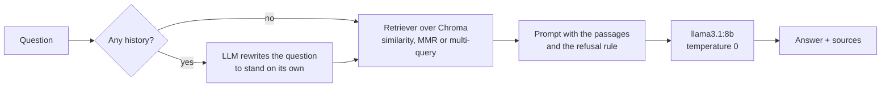

# rag-gta

A local RAG, with no paid API and no data leaving the machine: **Ollama** (`llama3.1:8b` and
`nomic-embed-text`) + **Chroma** + **LangChain**. It answers in Portuguese over two corpora:

- **lore:** the Grand Theft Auto universe, from GTA Wiki articles, with the source of each answer;
- **glossary:** an EN → PT-BR video game localization glossary that I co-authored, which shows the same pipeline in
  a terminology domain, where the answer has to come out *exactly* as it is in the source.

It also has an **evaluation set** that measures separately whether the system found the right passage, whether
it answered correctly and whether it admitted when it did not know.

## How it works



- **Ingestion** (`rag_gta/corpus.py`): the lore text is split by wiki article (each article carries its URL) and
  then into 1,500-character chunks with a 300-character overlap; each chunk keeps the title and URL of its source
  article. The glossary becomes **one document per term**, with no splitting: a chunk that separates the term
  from its translation is useless.
- **Retrieval** (`rag_gta/pipeline.py`): three modes, chosen with `--mode`.
  - `similarity`: the *k* closest chunks. Default for the glossary (k = 4).
  - `mmr`: relevant but different from each other, so it does not bring *k* pieces of the same paragraph.
    Default for the lore (k = 8).
  - `multiquery`: the LLM rewrites the question several ways and merges the results. It costs one extra call.
- **Generation:** the prompt says to use only the passages and, when they hold no answer, to say a fixed refusal
  sentence, which makes refusals measurable.
- **Conversation:** in `chat` mode, a question like "e o irmão dele?" ("and his brother?") is rewritten with the
  history before the search.

## Running it

Requirements: Python 3.11+ and [Ollama](https://ollama.com) running.

```bash
ollama pull llama3.1:8b
ollama pull nomic-embed-text

python -m venv .venv
source .venv/bin/activate        # Windows: .venv\Scripts\activate
pip install -r requirements.txt

# Glossary: the file is already in the repository
python -m rag_gta ask glossary "Como traduzo cooldown?"
python -m rag_gta eval glossary

# Lore: the corpus is built from the GTA Wiki (see "The data")
python -m rag_gta.lore_corpus
python -m rag_gta index lore
python -m rag_gta ask lore "Quem é o irmão de Carl Johnson?" --show-chunks
python -m rag_gta chat lore
python -m rag_gta eval lore --mode mmr
python -m rag_gta eval lore --mode multiquery
```

The vector index lives in `data/chroma/<corpus>/` and is only built the first time (`--rebuild` rebuilds it).
Other models: the `RAG_LLM` and `RAG_EMBED` variables.

## Evaluation

`eval/glossary.jsonl` (15 questions with an answer + 4 that must be refused) and `eval/lore.jsonl` (10 + 3). Each
answerable question lists the expected terms; scoring ignores case and accents.

| Metric | What it measures | If it is low, change |
|---|---|---|
| `retrieval_hit` | the expected term was in the retrieved passages | chunking, *k*, search mode, embeddings |
| `answer_hit` | the expected term is in the answer (and it is not a refusal) | prompt, model |
| `false_refusal` | the model refused a question that had an answer | prompt (refusal rule too strong) |
| `refusal_ok` | the model refused the question outside the corpus | prompt (hallucination) |

### Results

Glossary, `llama3.1:8b` + `nomic-embed-text`, CPU-only GitHub Actions runner, 2026-11-05
([run](https://github.com/ddmdros/rag-gta/actions/runs/42052451659)):

| Mode | `retrieval_hit` | `answer_hit` | `false_refusal` | `refusal_ok` | s/question |
|---|---|---|---|---|---|
| similarity | 15/15 | 15/15 | 0 | 3/4 | 16 |
| mmr | 14/15 | 14/15 | 0 | 3/4 | 16 |
| multiquery | 15/15 | 15/15 | 0 | 4/4 | 66 |

- With `similarity` and `mmr`, the model answers about *perk*, which is not in the glossary, instead of refusing.
  `multiquery` gets the refusal right, but takes about 4 times longer per question.
- `mmr` misses *damage per second*: by fetching passages that differ from each other, it leaves out the closest
  term. In a glossary, where each document is one term, diversity hurts; that is why the glossary default is
  `similarity`.

Lore, same models and runner, 2026-11-05 ([run](https://github.com/ddmdros/rag-gta/actions/runs/42053328578)),
corpus of 17 articles (391,545 characters, 364 chunks):

| Mode | `retrieval_hit` | `answer_hit` | `false_refusal` | `refusal_ok` | s/question |
|---|---|---|---|---|---|
| similarity | 10/10 | 9/10 | 0 | 3/3 | 149 |
| mmr | 10/10 | 9/10 | 0 | 3/3 | 124 |
| multiquery | 10/10 | 10/10 | 0 | 0/3 | 203 |

- Retrieval found the expected passage for every question in all three modes, with English articles and
  Portuguese questions. Every miss is in generation, not in search.
- `similarity` misses CJ's brother (l05) and `mmr` misses Vice City's protagonist (l04): the passage was in the
  context, but the answer did not contain the expected name, and it was not a refusal either.
- `multiquery` answers all ten but refuses none of the three questions outside the corpus (the capital of
  Australia, Tommy Vercetti's carrot cake recipe, the 2002 World Cup): the opposite of the glossary, where it was the
  only mode that refused everything. The answers are in the run's `eval-results` artifact. Because a wrong answer to
  an out-of-scope question is worse than a slow one, the lore default stays `mmr`.
- The three city articles (Los Santos, Liberty City, Vice City) come out with only 90 to 157 characters of prose.
  The city questions (l06 to l08) still pass because the game articles name the real cities, but the article list
  should point to fuller pages.

Each run writes the answers, the sources and the summary to `eval/results/`, to compare configurations. The
glossary's expected terms are checked against the CSV in a test (`tests/test_evaluate.py`): the evaluation tests
the system, not the memory of whoever wrote the questions.

With no local machine, the evaluation runs on GitHub Actions: the **Eval** workflow (Actions → Eval → Run
workflow) installs Ollama on the runner, runs the requested modes and publishes the run summary and the files in
`eval/results/`. The runner has only a CPU, so a run takes tens of minutes, but the score is the same.

## The data

- **Glossary** (`data/glossario_gamer_ptbr.csv`): *Video Games Localization Glossary – Portuguese (Brazil)*, by
  Diogo Medeiros and Bruna Beatriz Gabriel, published in Lucile Danilov's
  [Multilingual Gameloc Glossaries](https://locdandloaded.net/2022/06/14/multilingual-gameloc-glossaries/), a collaborative project with one glossary per language written by
  translators from the localization community. Distributed under
  [CC BY-NC 4.0](https://creativecommons.org/licenses/by-nc/4.0/). Since I know which term each entry should give,
  the glossary evaluation checks answers against terms I can vouch for.
- **Lore** (`data/gta_bible.txt`, not in git): text from [GTA Wiki](https://gta.fandom.com) articles, whose
  content is under [CC BY-SA](https://www.fandom.com/licensing). The text is not versioned:
  `python -m rag_gta.lore_corpus` downloads a fixed list of articles through the wiki's API (the protagonists,
  the people around them, and the cities and games the evaluation asks about) and keeps only the prose, with no
  infobox, table or references. The list is fixed so that anyone can rebuild the same corpus and compare runs.
  The articles are in English and the questions in Portuguese, so the lore evaluation also tests cross-language
  retrieval. The first version of the project used a corpus built by a different scraping script, which is not
  in the repository.

  To use other articles, build your own `.txt` in the same format, with each article's URL on a line before its
  text:

  ```text
  https://gta.fandom.com/wiki/Carl_Johnson
  Carl Johnson, also known as CJ, is the protagonist of Grand Theft Auto: San Andreas...

  https://gta.fandom.com/wiki/Sweet_Johnson
  ...
  ```

  The pipeline uses these URLs as the source of each answer. Grand Theft Auto is a trademark of Rockstar Games;
  this is a study project, unrelated to the company.

## Tests

```bash
python -m unittest discover -s tests -v
```

The tests run without Ollama: they use the real Chroma in a temporary folder, with fake embeddings and a fake chat
model (`DeterministicFakeEmbedding`, `FakeListChatModel`). They check the part that does not depend on the
model's quality: reading the glossary, splitting by article, one retrieval per question, sources returned with
the answer, the question rewritten with history, and the evaluation score. CI runs the tests on every push.

## How the project evolved

The git history keeps the earlier versions, which lived in separate files under `src/`:

1. **CrewAI agent + glossary** (`agent.py`): an agent with a Chroma search tool.
2. **Retrieval chain** (`rag_langchain.py`): the same glossary with `create_retrieval_chain`, no agent.
3. **Agent over the lore** (`agent_gta.py`): a persistent on-disk index.
4. **LCEL + MMR** (`rag_langchain_gta.py`, `agent_gta_3.py`): a chain with the `|` operator, diverse search and
   debugging of the retrieved passages.
5. **Memory** (`agent_gta_2.py`): per-session history.
6. **Multi-query and sources** (`agent_gta_4.py`): question rewriting and links to the articles.

The current version brings everything into one package, with the three search modes as an option, and fixes what
the earlier versions let slip:

- retrieval ran twice per question (once for the context, once for the sources);
- the CSV's header and license went into the index as if they were terms;
- the prompt that rewrites the question with history existed, but was never used;
- the loaders came from `langchain-community`, which was discontinued.

## Credits

Built as a pair by Diogo Medeiros ([GitHub](https://github.com/ddmdros)) and Stephanie Pinho
([GitHub](https://github.com/stephanielumertz), [LinkedIn](https://www.linkedin.com/in/stephanielumertz/)).
The package reorganization, the evaluation and the tests came later, in November 2026.
